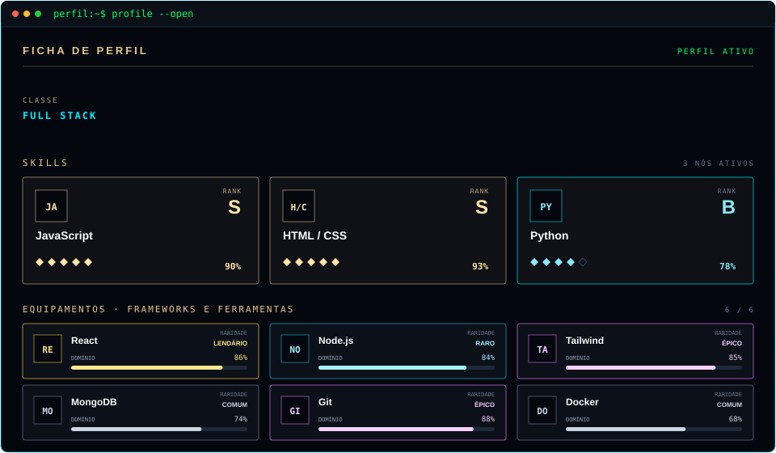
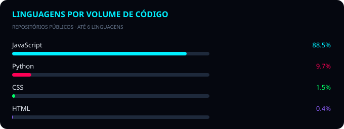

# Carlos Eduardo

### Desenvolvedor Full Stack | React, Node.js e Python

---

## Sobre mim

Sou desenvolvedor Full Stack de Resende (RJ). Minha relação com tecnologia começou há cerca de 20 anos e, nos últimos 7, tenho me dedicado ao desenvolvimento de software. Gosto de entender como as coisas funcionam, testar ideias e transformá-las em projetos.

Fora do código, gosto de games, RPGs, animes, filmes e ficção científica, especialmente cyberpunk. Essas referências também influenciam meu interesse por interfaces e projetos digitais.

## Skills e ferramentas

Os percentuais seguem minha avaliação pessoal e os níveis configurados no meu site. **Ranks:** S (mestre), A (avançado), B (intermediário) e C (iniciante).

## Linguagens nos meus repositórios

O gráfico considera o volume de código nos meus repositórios públicos, não meu nível de domínio. A GitHub Action atualiza os dados a cada seis horas.

## Projeto em destaque

### KADUH.DEV — Portfólio pessoal

Meu portfólio pessoal é bilíngue e reúne informações sobre mim, minhas habilidades e meus projetos. Os repositórios em destaque vêm do GitHub.

**Tecnologias:** React, JavaScript, Tailwind CSS, Node.js e MongoDB.

[Explorar meus repositórios públicos](https://github.com/Carlos-Eduardo-MA?tab=repositories)

## Vamos conversar?

Se quiser falar sobre tecnologia, projetos ou uma oportunidade, entre em contato:

- **LinkedIn:** [linkedin.com/in/carloseduardomarcelino](https://www.linkedin.com/in/carloseduardomarcelino/)
- **E-mail:** [carloseduardo.ma89@gmail.com](mailto:carloseduardo.ma89@gmail.com)
- **Instagram:** [@KaduhAlmeida](https://instagram.com/KaduhAlmeida)
- **GitHub:** [@Carlos-Eduardo-MA](https://github.com/Carlos-Eduardo-MA)

---

